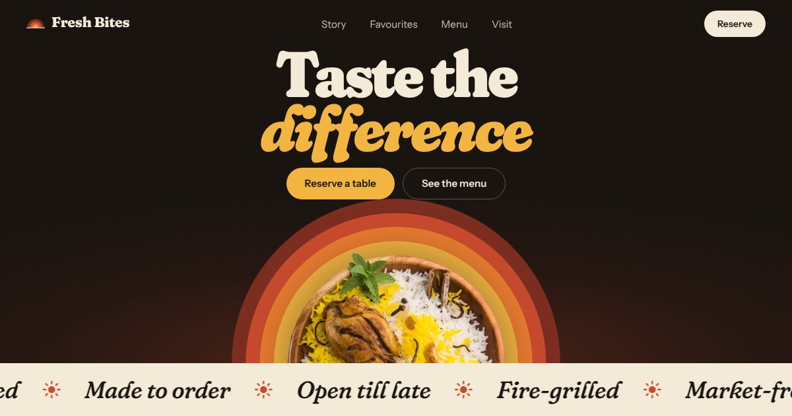

# Fresh Bites Grill

A concept site for a fire-grilled restaurant under the red rocks of Sedona, Arizona.
Built as a portfolio piece by [Elpis](https://elpis.cc).



## Design

The art direction is "desert sunset": a 70s-modern Southwest identity built from the place itself.

- **Palette** – espresso night, sandstone paper, and a saffron → ember → red-rock sunset. Juniper green is the one cool note.
- **Type** – [Fraunces](https://fonts.google.com/specimen/Fraunces) set heavy and soft for display, [Instrument Sans](https://fonts.google.com/specimen/Instrument+Sans) for everything else.
- **Motifs** – the rising sun (hero bowl, logo, favicon, dividers), adobe arches (image frames, dish cards) and a mesa skyline that the reservation section rises out of.
- **Motion** – inertial scrolling, a scroll-driven hero, a word-by-word story reveal, parallax frames, a velocity-aware ticker, and a menu whose dish photos trail the cursor. Everything stands down for `prefers-reduced-motion`.

## Details worth a look

- The menu is edited in [Sanity](https://fresh-bites.sanity.studio/) and revalidated every five minutes; a local snapshot keeps the page alive if the CMS is unreachable.
- "Open now" is computed live in the restaurant's own time zone, wherever the visitor is.
- The reservation ticket posts through EmailJS and has real sending, success and error states.
- Touch devices get inline dish thumbnails and a swipeable favourites rail in place of hover effects.

## Stack

Next.js (pages router) · TypeScript · Tailwind CSS · Framer Motion · Lenis · Sanity · EmailJS

## Develop

```bash
npm install
npm run dev
```

Open http://localhost:3000.

```bash
npm run build
```

Set `NEXT_PUBLIC_SITE_URL` to the deployed origin if it is not hosted on Vercel, so social cards get an absolute image URL.

## Structure

```
pages/                  routes (index, 404) and the app shell
source/site.ts          names, links, contact details
source/lib/             menu (CMS + fallback), opening hours, fonts, scrolling
source/components/      one folder per page section, plus shared pieces in general/
source/assets/          photography and cut-outs, optimised by next/image
```
